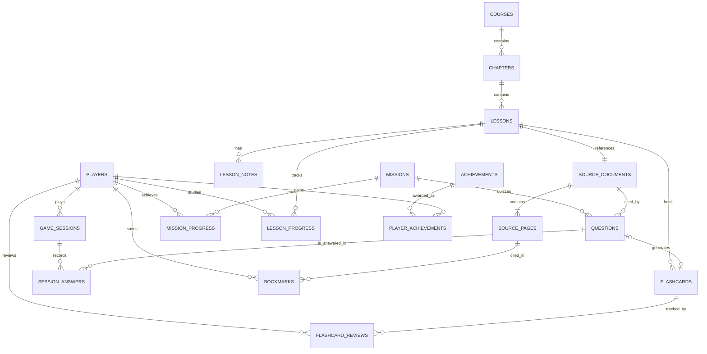

# VNR202 — Thiết kế database PostgreSQL / Neon

## Mục tiêu dữ liệu

Học liệu được lưu theo thứ bậc `VNR202 → 4 chương → 29 buổi học → 29 nguồn PDF → 435 trang`. Với mỗi câu hỏi, database giữ mã buổi/trang PDF làm căn cứ kiểm tra. Người học có thể chơi game, ghi nhớ flashcard, đọc tài liệu, ghi chú và lưu tiến độ.

## Quan hệ chính

## Nguyên tắc thiết kế

- **Khoá chính và khóa ngoại** đầy đủ cho dữ liệu học, lượt chơi và các trang nguồn.
- **Upsert khi seed**: nạp lại tài liệu và câu hỏi mẫu nhưng không xóa tài khoản hoặc kết quả đang có.
- **Kiểm tra số trang có thật**: câu hỏi / thẻ ghi nhớ / bookmark trỏ đến cặp khóa `(document_id, page_number)`.
- **Độc lập phần nội dung và phần game**: bổ sung PDF/lesson mới không bắt buộc tạo chiến dịch mới.
- **Bảo tồn đề thi tự biên soạn**: câu hỏi seed gắn `review_status='review_needed'`, tránh giả định đây là đề thi giảng viên duyệt.
- **Dữ liệu cập nhật**: `source_pages.content` lấy từ PDF, ảnh đồ họa vẫn ở file PDF gốc.

## Quy tắc thêm nội dung

- Thêm **câu hỏi**: dùng `npm run db:import:questions -- file.json`; không nhập đáp án vào frontend.
- Thêm **buổi học/PDF**: `python scripts/import-pdf.py ...` rồi `npm run db:init`.
- Thêm **ghi chú**: insert vào `lesson_notes` như file ví dụ.
- Thêm **chiến dịch**: cần thêm một hàng vào `missions` và ít nhất một câu vào `questions`; nếu muốn seed qua source code, sửa `scripts/seed-data.js`.

## Dữ liệu khởi tạo

| Bảng | Số bản ghi ban đầu |
|---|---:|
| courses | 1 |
| chapters | 4 |
| lessons | 29 |
| source_documents | 29 |
| source_pages | 435 |
| missions | 6 |
| questions | 60 |
| flashcards | 60 |
| timeline_events | 13 |
| achievements | 4 |
| Các bảng liên quan người dùng | 0 |

Các view `v_lesson_catalog`, `v_question_sources` hỗ trợ xây dựng màn quản trị sau này. Các tính năng review flashcard, bookmark và huy hiệu hiện **mới có schema**, chưa có UI/logic hoàn chỉnh.
